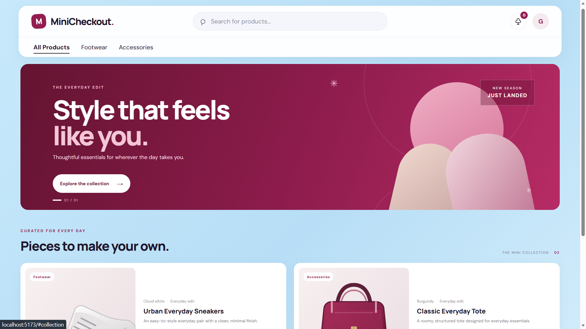
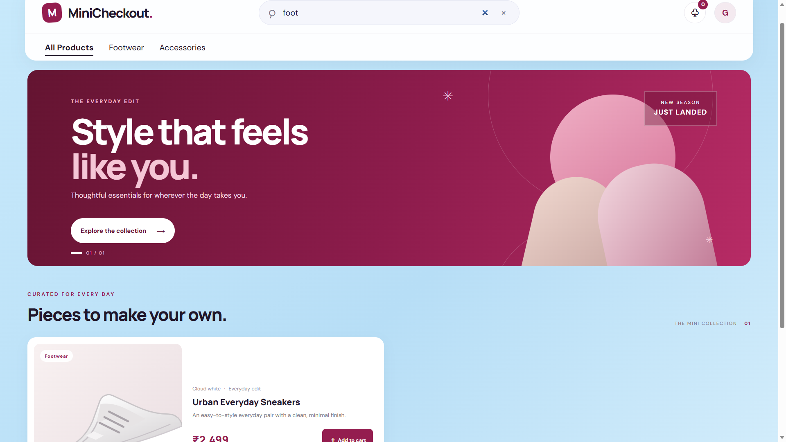
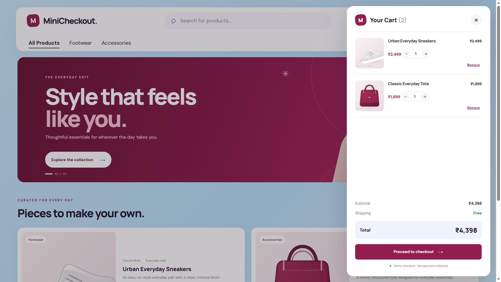
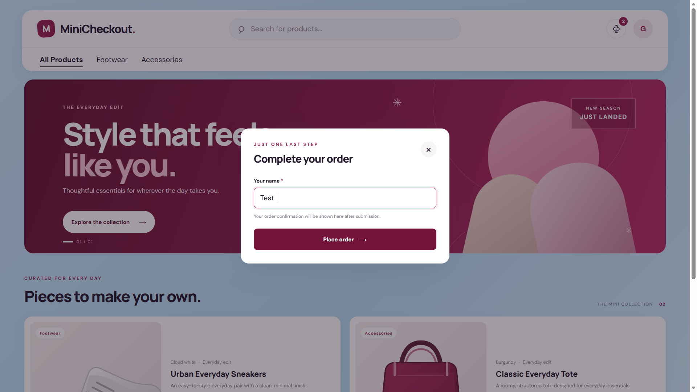
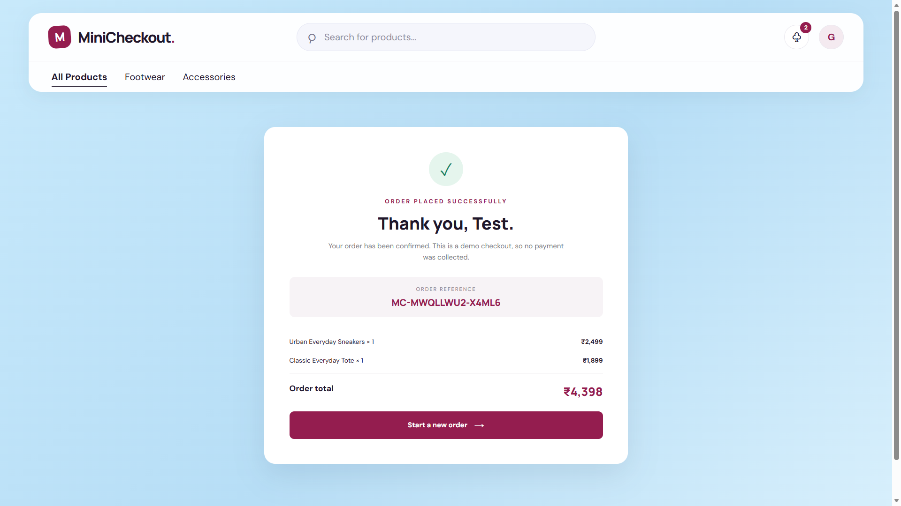
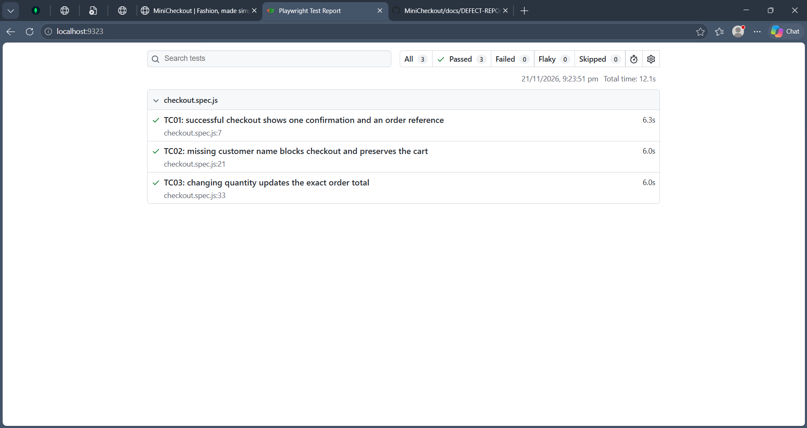

# MiniCheckout

A fashion-inspired, single-page retail checkout application built to demonstrate reliable shopping-cart behaviour, checkout validation, and browser-based quality testing.

## Project Overview

MiniCheckout is a frontend-only fashion retail application developed as part of the **Fynd HackQuest SDET Intern challenge**, based on the Mini Checkout and Browser Test Suite assignment.

The project features two synthetic fashion products, a responsive storefront, product search and category filtering, shopping-cart management, quantity updates, customer-name validation, and order confirmation with a generated reference.

It also demonstrates practical software quality assurance through Playwright-based browser automation, covering successful checkout, input validation, accurate cart calculations, and manual testing of duplicate submissions.

**This is an independent educational submission. No real payments are collected, and no backend or database is used.**

## Product Catalogue

| Product | Product ID | Fixed Price |
|---|---|---:|
| Urban Everyday Sneakers | CF-001 | ₹2,499 |
| Classic Everyday Tote | CF-002 | ₹1,899 |

## Features

- Responsive fashion-inspired storefront.
- Two fixed-price synthetic products.
- Product search by name, category, description, and colour.
- Category filtering.
- Add and remove products from the shopping cart.
- Increase and decrease product quantities.
- Automatic line-total and order-total calculations.
- Required customer-name validation.
- Cart preservation when validation fails.
- Order confirmation with a generated reference.
- Protection against duplicate order submissions.
- Automated browser testing with Playwright.

## Technology Stack

- **Frontend:** React, JavaScript
- **Build Tool:** Vite
- **Styling:** CSS
- **Browser Automation:** Playwright
- **Deployment:** Vercel
- **Version Control:** Git and GitHub

## Requirements

- Node.js 18 or later
- npm
- Chromium-compatible testing environment

## Run Locally

Clone the repository:

```bash
git clone https://github.com/Ishanya-Jha/MiniCheckout.git
```

Navigate into the project:

```bash
cd MiniCheckout
```

Install dependencies:

```bash
npm install
```

Start the development server:

```bash
npm run dev
```

Open the local URL printed by Vite, normally:

```text
http://localhost:5173
```

## Run Browser Tests

Install the Playwright Chromium browser:

```bash
npx playwright install chromium
```

Execute the automated test suite:

```bash
npm run test:e2e
```

Open the HTML test report:

```bash
npm run test:report
```

The Playwright configuration starts the Vite development server automatically when the tests run.

## Automated Test Coverage

The project includes three mandatory automated checkout scenarios.

| Test ID | Scenario | Expected Result |
|---|---|---|
| TC01 | Successful checkout | One confirmation appears with the customer name and order reference |
| TC02 | Missing customer name | Validation error appears, no confirmation is created, and cart contents remain intact |
| TC03 | Quantity update | Increasing sneaker quantity from 1 to 2 updates the order total to exactly ₹4,998 |

### Testing Approach

- Playwright browser automation.
- Customer-facing locators using accessible roles and labels.
- Assertions that verify visible application behaviour.
- Fresh storefront navigation before each automated test.
- No unnecessary fixed delays.

### Recorded Test Results

- **Automated tests passed:** 3
- **Automated tests failed:** 0
- **Manual scenarios passed:** 2
- **Automated execution time:** 12.1 seconds

See `docs/TEST-PLAN.md`, `docs/TEST-RESULTS.md`, and `docs/DEFECT-REPORT.md` for detailed testing documentation.

## Manual Testing

Two additional scenarios were verified manually:

1. **MT01 - Empty Cart:** Attempting to proceed to checkout without adding a product prevents checkout.
2. **MT02 - Rapid Double Submission:** Rapidly clicking Place Order does not produce duplicate confirmations.

Only observed and reproducible results are recorded in the test documentation.

## Application Screenshots

### 1. Storefront

The MiniCheckout storefront featuring the fashion-inspired design and product catalogue.



### 2. Product Search and Category Filters

Demonstrates product search and category-based filtering.



### 3. Shopping Cart

Displays selected products, quantity controls, subtotal, and order total.



### 4. Checkout - Customer Name Entry

Shows the required customer-name field before order submission.



### 5. Order Confirmation

Displays successful order placement, customer name, generated order reference, and order summary.



## Automated Testing Evidence

### Playwright Test Report

The Playwright report demonstrates the results of the three automated checkout tests.



**Test Execution Summary:**

| Metric | Result |
|---|---:|
| Total tests | 3 |
| Passed | 3 |
| Failed | 0 |
| Flaky | 0 |
| Skipped | 0 |
| Execution time | 12.1 seconds |

**Automated test cases:**

- TC01: Successful checkout and order reference.
- TC02: Missing customer name validation.
- TC03: Quantity update and exact order total.

## Project Structure

```text
MiniCheckout/
│
├── public/
│   └── images/
│
├── src/
│   ├── components/
│   ├── data/
│   ├── hooks/
│   ├── utils/
│   ├── App.jsx
│   └── styles.css
│
├── tests/
│   └── checkout.spec.js
│
├── docs/
│   ├── screenshots/
│   │   ├── storefront.png
│   │   ├── search-filters.png
│   │   ├── shopping-cart.png
│   │   ├── checkout-name-entry.png
│   │   ├── order-confirmation.png
│   │   └── playwright-test-results.png
│   │
│   ├── TEST-PLAN.md
│   ├── TEST-RESULTS.md
│   └── DEFECT-REPORT.md
│
├── index.html
├── package.json
├── playwright.config.js
└── README.md
```

## Design Notes

The visual direction combines:

- Pale sky-blue backgrounds.
- Clean white surfaces.
- Burgundy accents.
- Minimal fashion-retail product presentation.
- Responsive layouts and clear checkout interactions.

The project uses its own branding and synthetic products. It is not an official Fynd product or integration.

## Scope and Limitations

- No real payment processing.
- No account creation or authentication.
- No backend or database.
- No inventory or shipping integrations.
- No external APIs or commerce services.
- Product search and category filtering operate locally on the available synthetic catalogue.

## Live Demo and Repository

- **Live Application (Vercel):** https://mini-checkout-six.vercel.app/
- **GitHub Repository:** https://github.com/Ishanya-Jha/MiniCheckout

## Deployment

The application can be deployed as a static Vite project using Vercel.

| Setting | Configuration |
|---|---|
| Framework Preset | Vite |
| Build Command | `npm run build` |
| Output Directory | `dist` |
| Install Command | `npm install` |
| Root Directory | `./` |

## License

Created as an educational hackathon project for the Fynd HackQuest SDET Intern challenge.
